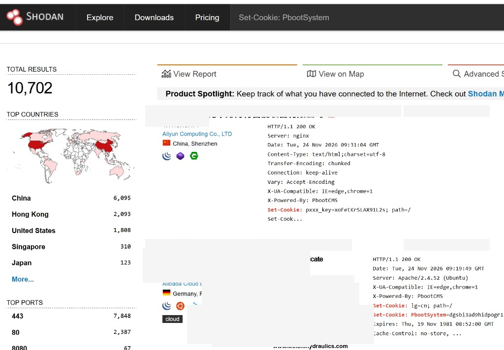

# PbootCMS-Go

用 Go 写的类 PbootCMS 建站系统：熟悉的标签与后台习惯，默认更安全、可审计、可容器化；Pboot 站数据尽量可迁。

**许可**：本项目源码采用 [MIT License](LICENSE)，可自由使用、修改与商用；请自行遵守第三方组件、字体及所附站点模板等许可。

---

## 为什么用 Go

| 点 | 说明 |
| --- | --- |
| 单进程 | 一个二进制听 HTTP，无 PHP-FPM / 插件沙箱链 |
| 类型与边界 | 上传、签名、路径在编译期与显式校验里收紧 |
| 部署 | 静态链接友好，适合 Docker 只读根文件系统 |
| 内存模型 | 无典型「任意 include / eval」面 |

相对 PHP 版 Pboot 常见问题（SQL 注入、标签解析导致写文件/执行代码、可写目录被当脚本执行、弱默认后台等），Go 实现从查询与模板层就避开了这些入口。

### 代价与弊端

- **部署成本高于 PHP**：需常驻进程或容器（VPS / 云主机 / Docker）；不少仅 PHP 的虚拟主机无法直接部署。
- **标签并非 100% 兼容**：如 `{pboot:2nav}` 等需后续补齐；复杂 DIY SQL / 扩展要人工核对。
- **运维习惯不同**：不是「丢进 Nginx + PHP」即跑。
- **生态插件**：不能直接装 Pboot 的 PHP 插件。
- **模板调试**：报错与 PHP 版不同，排错路径要重新熟悉。

---

## 安全机制

常见风险多来自可被批量识别的特征、固定后台路径，以及认出之后套用该类系统上已知的问题，而不是单一冷门漏洞。本节说明大致如何发生、本系统如何对应，不展开具体利用方法。

### 对方怎么发现、怎么打

**指纹（响应头 / Cookie / 图标等）**

源码自报家门：`X-Powered-By: PbootCMS`，会话 Cookie 名 `PbootSystem`。测绘平台可直接检索——例如 Shodan 搜 `Set-Cookie: PbootSystem`，量级常上万；命中里多半还有 `X-Powered-By: PbootCMS`。（图中站点名 / 域名 / IP 已打码。）



默认站点根目录的 `favicon.ico` 也是常见指纹：官方包自带固定图标，FOFA / Shodan 可按图标哈希圈站（如 FOFA `icon_hash="..."`、Shodan `http.favicon.hash:...`）。未改图标的站，即使用户去掉了产品头，仍可能被哈希撞出来。

| 平台 | 示例条件 |
| --- | --- |
| FOFA | `header="PbootCMS"` / `header="PbootSystem"` / `header="Set-Cookie: PbootSystem"` / `icon_hash="…"` |
| Shodan | `"X-Powered-By: PbootCMS"` / `"Set-Cookie: PbootSystem"` / `http.favicon.hash:…` |

除头 / Cookie / 图标外，常见发现方式还有：

| 类型 | 典型特征 |
| --- | --- |
| 固定入口 | `/admin`、`/admin.php`、文档写死的后台路径 |
| 页面正文 | `content="PbootCMS"`、标题或页脚带产品名、未渲染完的 `{pboot:…}` 标签残留 |
| 特有路径 | `/core/`、`/apps/`、编辑器 `ueditor` 固定 URL、可下载的备份/SQL 路径 |
| 静态资源哈希 | 默认皮肤 CSS/JS、后台 logo 等文件的 MD5 / 内容特征 |
| 默认口令与安装残留 | 文档默认账号、安装锁/说明页、测试数据标题 |
| URL 形态 | 特定伪静态或查询串习惯（需结合其它特征，单独命中较弱） |

再叠加上述特征，站点一旦被识别为该类系统，弱口令尝试、已知问题上的自动化检测就会对准它。

本系统已覆盖：首次 `admin_path` / `cookie_salt` 自动生成、不发品牌头、Cookie 名由盐派生、可一键重置路径/盐/库名；**不附带默认 favicon / Logo**（避免图标哈希指纹）。站点按需自行放置图标。

**认出之后的常见利用**

- **SQL 注入**：把搜索词、筛选条件等用户输入直接拼进 SQL，读出或改掉库数据（如管理员哈希）。不一定走模板标签——前台搜索、列表条件、后台查询、自定义 SQL 都可能中招；标签里的 `filter=` 只是其中一种常见入口。
- **标签解析**：`{pboot:if(...)}` 等曾用类似 `eval` 的方式处理条件；过滤不严时，可在解析阶段执行危险逻辑，进而**向可写目录写入脚本**或调用系统命令。
- **缓存与上传目录**：往既能写入、又能通过网址交给 PHP 执行的目录放脚本（如 `data/cache`、上传目录），或用异常扩展名、远程拉图等绕过检查。一旦交给 PHP 运行，就等于在服务器上执行代码。
- 此外还有关闭 API 签名、跨站请求伪造、错误页泄露路径等，会进一步放大风险。

### 对应防护

| 风险点 | 本系统做法 |
| --- | --- |
| 扫固定 `/admin`、固定 Cookie 名 / 产品头 / 默认 favicon | 随机 `admin_path` + `cookie_salt`；**不发**品牌 `X-Powered-By`；Cookie 名为盐派生短哈希；**不提供**默认 `favicon.ico` / Logo；可一键重置指纹 |
| 搜索 / 筛选等拼进 SQL | Ent 参数化 + 字段白名单；取值不拼进语句字符串 |
| `{pboot:if}` 等解析导致写文件或执行代码 | 条件仅安全表达式求值（`textmod.Truth`）；无 `eval`；无 PHP 解释器 |
| 往缓存 / 上传目录放脚本再访问 | 扩展名白名单 + 登录/CSRF；静态只下载、不执行代码 |
| 扫 `/data`、`/apps`、备份 | 静态**白名单**；拒绝 `.db` / `.sql` / `.php` / `static/backup` |
| SSRF / 撞库 / CSRF / 关签 API | 远程 URL 校验、登录限速、强密码、`formcheck`、API **始终**验签 |
| 同机其它用户读到会话、密钥盐、数据库文件 | 敏感目录权限收紧（如 `0750`），盐与库文件仅所有者可读写（如 `0600`） |

**架构差异**：少了「用户输入拼进 SQL」「标签交给 `eval`」「Web + PHP 执行可写目录」这几层经典入口，防护主要靠查询与模板的实现方式，而不是事后多写几条过滤。

不能保证绝对安全：关强密码、泄露后台路径、卷权限乱放、密钥进公开镜像，或 DIY 扩展里自己拼 SQL，仍会出事。

---

## 开发

本地改代码、联调时：安装 Go（版本见 `go.mod`），准备一份站点数据（模板、静态资源、数据库），复制 `config.example.json` 为 `config.json` 后改 `site_root` / `dsn`（`config.json` 已在 `.gitignore`，勿提交真实盐与后台路径）。

```bash
cp config.example.json config.json
# 按需修改 config.json 后启动：
go run ./cmd/pbootcms-go
```

`config.json` 示例：

```json
{
  "addr": ":8080",
  "driver": "sqlite",
  "dsn": "site/data/pbootcms.db",
  "site_root": "site",
  "admin_path": "auto",
  "cookie_salt": ""
}
```

- `site_root`：站点根目录（内含 `template`、`static`、`skin`、`data` 等）。
- `admin_path` 为 `auto` / `random` 时首次启动会生成随机后台路径；`cookie_salt` 为空则自动生成。
- 可用环境变量覆盖：`GBOOT_CONFIG`、`GBOOT_ADDR`、`GBOOT_DRIVER`、`GBOOT_DSN`、`GBOOT_SITE_ROOT`、`GBOOT_ADMIN_PATH`、`GBOOT_COOKIE_SALT`。
- 数据库驱动：`sqlite` / `mysql` / `pgsql`。

仓库里常改的部分：

```
cmd/pbootcms-go/   程序入口
internal/       HTTP、后台、模板、鉴权等
docker/         容器相关
config.json     本地配置（勿把真实盐与后台路径提交到公开仓库）
```

---

## 部署

生产优先 **容器**；二进制直跑适合小规模或无 Docker 的环境。上线前过一遍本节末尾清单。

### 本地 / 二进制部署

下面以 Linux 为例（路径可按机器调整）。假设安装目录为 `/opt/pbootcms-go`，用专用用户 `gboot` 运行。

#### 1. 准备目录

```bash
sudo useradd -r -s /usr/sbin/nologin gboot   # 若已有用户可跳过
sudo mkdir -p /opt/pbootcms-go
sudo chown gboot:gboot /opt/pbootcms-go
```

推荐布局：

```text
/opt/pbootcms-go/
  pbootcms-go      # 可执行文件
  config.json       # 进程配置
  site/             # site_root：模板、静态、数据
    template/
    static/
      upload/       # 需可写
      backup/       # 需可写（勿对公网直接映射）
    skin/
    data/           # 需可写（会话、缓存、SQLite 等）
```

把迁好的站点内容放进 `site/`（或从原 Pboot 站拷贝 `template`、`static`、`skin`、`data`）。SQLite 时确保库文件在 `site/data/` 下。

#### 2. 编译并安装二进制

在有 Go 的机器上：

```bash
git clone <本仓库地址> pbootcms-go-src
cd pbootcms-go-src
go build -trimpath -ldflags="-s -w" -o pbootcms-go ./cmd/pbootcms-go

sudo install -o gboot -g gboot -m 755 pbootcms-go /opt/pbootcms-go/pbootcms-go
```

也可在本机交叉编译后拷上去，例如：

```bash
GOOS=linux GOARCH=amd64 go build -trimpath -ldflags="-s -w" -o pbootcms-go ./cmd/pbootcms-go
scp pbootcms-go user@server:/tmp/
# 再在服务器上 install 到 /opt/pbootcms-go/
```

#### 3. 写配置

`/opt/pbootcms-go/config.json` 示例（SQLite）：

```json
{
  "addr": "127.0.0.1:8080",
  "driver": "sqlite",
  "dsn": "/opt/pbootcms-go/site/data/pbootcms.db",
  "site_root": "/opt/pbootcms-go/site",
  "admin_path": "auto",
  "cookie_salt": ""
}
```

MySQL 示例（把 `driver` / `dsn` 换成实际库）：

```json
{
  "addr": "127.0.0.1:8080",
  "driver": "mysql",
  "dsn": "user:pass@tcp(127.0.0.1:3306)/pbootcms?parseTime=true&charset=utf8mb4",
  "site_root": "/opt/pbootcms-go/site",
  "admin_path": "auto",
  "cookie_salt": ""
}
```

说明：

- `addr` 建议只监听本机，由 Nginx 反代；若直接对外可写 `":8080"`。
- 首次用 `admin_path: "auto"` 会生成随机后台路径并写回配置；也可用环境变量 `GBOOT_ADMIN_PATH` 固定。
- 配置文件权限建议：`chmod 600 config.json`，属主 `gboot`。

```bash
sudo chown gboot:gboot /opt/pbootcms-go/config.json
sudo chmod 600 /opt/pbootcms-go/config.json
```

#### 4. 权限

```bash
sudo chown -R gboot:gboot /opt/pbootcms-go/site
sudo find /opt/pbootcms-go/site -type d -exec chmod 755 {} \;
sudo find /opt/pbootcms-go/site -type f -exec chmod 644 {} \;
# 运行时要写的目录
sudo chmod 750 /opt/pbootcms-go/site/data \
  /opt/pbootcms-go/site/static/upload \
  /opt/pbootcms-go/site/static/backup
# SQLite 库文件（若已存在）
sudo chmod 600 /opt/pbootcms-go/site/data/*.db 2>/dev/null || true
```

程序启动时还会尽量把敏感路径收到类似权限；部署时先显式设好更稳妥。

#### 5. 先手动跑通

```bash
cd /opt/pbootcms-go
sudo -u gboot ./pbootcms-go
# 或：sudo -u gboot env GBOOT_CONFIG=/opt/pbootcms-go/config.json ./pbootcms-go
```

浏览器访问 `http://服务器IP:8080/`（若只绑了 `127.0.0.1`，先在本机 curl 或临时改 `addr`）。看日志里打印的 `admin=` 路径，记下后台地址并完成首次登录 / 改密。确认无误后 `Ctrl+C` 停掉，再交给 systemd。

#### 6. systemd 保活

`/etc/systemd/system/pbootcms-go.service`：

```ini
[Unit]
Description=PbootCMS-Go
After=network.target

[Service]
Type=simple
User=gboot
Group=gboot
WorkingDirectory=/opt/pbootcms-go
ExecStart=/opt/pbootcms-go/pbootcms-go
Environment=GBOOT_CONFIG=/opt/pbootcms-go/config.json
Restart=on-failure
RestartSec=3
NoNewPrivileges=true
PrivateTmp=true

[Install]
WantedBy=multi-user.target
```

```bash
sudo systemctl daemon-reload
sudo systemctl enable --now pbootcms-go
sudo systemctl status pbootcms-go
sudo journalctl -u pbootcms-go -f
```

#### 7. Nginx 反代（HTTPS）

证书用 Let's Encrypt 等自行准备。应用层已有部分安全头与路径限制；反代再加一层边界防护。示例：

```nginx
# 建议在 http {} 里（只配一次）：
# limit_req_zone $binary_remote_addr zone=gboot_limit:10m rate=10r/s;
# ssl_session_cache shared:SSL:10m;
# ssl_session_timeout 1d;

server {
    listen 80;
    server_name www.example.com;
    return 301 https://$host$request_uri;
}

server {
    listen 443 ssl http2;
    server_name www.example.com;

    ssl_certificate     /etc/letsencrypt/live/www.example.com/fullchain.pem;
    ssl_certificate_key /etc/letsencrypt/live/www.example.com/privkey.pem;
    ssl_protocols       TLSv1.2 TLSv1.3;
    ssl_prefer_server_ciphers off;

    server_tokens off;
    client_max_body_size 32m;

    # 安全响应头（与程序侧互补；HSTS 仅 HTTPS）
    add_header Strict-Transport-Security "max-age=31536000; includeSubDomains" always;
    add_header X-Content-Type-Options    "nosniff" always;
    add_header X-Frame-Options           "SAMEORIGIN" always;
    add_header Referrer-Policy           "strict-origin-when-cross-origin" always;
    add_header Permissions-Policy        "geolocation=(), microphone=(), camera=()" always;

    # 边界拦截：敏感路径即使误配 alias 也不对外
    location ~* ^/(data|apps|core|template|config)(/|$) { return 404; }
    location ^~ /static/backup/ { return 404; }
    location ~* \.(sql|db|sqlite|bak|env|go|git)(/|$) { return 404; }
    location ~ /\. { return 404; }   # .git / .env 等

    # 可选：全站简单限速（需配合上面的 limit_req_zone）
    # limit_req zone=gboot_limit burst=20 nodelay;

    location / {
        proxy_pass http://127.0.0.1:8080;
        proxy_http_version 1.1;
        proxy_set_header Host              $host;
        proxy_set_header X-Real-IP         $remote_addr;
        proxy_set_header X-Forwarded-For   $proxy_add_x_forwarded_for;
        proxy_set_header X-Forwarded-Proto $scheme;
        proxy_set_header Connection        "";
        proxy_read_timeout  60s;
        proxy_send_timeout  60s;
        proxy_buffering on;
    }
}
```

要点：

- `X-Forwarded-Proto` 供程序识别 HTTPS（Cookie `Secure`、应用侧 HSTS）。
- **不要**对 `site/data`、`site/static/backup` 再写 `alias` / `root` 指到公网；静态文件交给后端白名单即可。
- `location` 拦截是纵深防御，不能代替应用内的路径与上传校验。

#### 8. 升级

```bash
# 编译新二进制后：
sudo systemctl stop pbootcms-go
sudo install -o gboot -g gboot -m 755 pbootcms-go /opt/pbootcms-go/pbootcms-go
sudo systemctl start pbootcms-go
```

升级前备份 `config.json` 与 `site/data`（及 MySQL 库）。

### 容器部署（推荐）

相关文件：`Dockerfile`、`docker-compose.yml`、`docker/entrypoint.sh`、`docker/config.docker.json`。

镜像内用户 `gboot`（uid/gid **10001**）；入口以 root 短暂修卷权限后降权；默认 `read_only` + `cap_drop: ALL`。

#### 容器相对「裸机跑二进制」的安全优势

| 点 | 说明 |
| --- | --- |
| 非 root | 入口脚本修卷属主后 `su-exec` 降权再跑 |
| 只读根文件系统 | `read_only: true`，业务写不进镜像层 |
| 能力收敛 | `cap_drop: ALL` + `no-new-privileges` |
| 可写面最小 | 仅卷：`data`、`static/upload`、`static/backup` |
| 配置隔离 | 环境变量注入；只读根下运行时 config 拷到 tmpfs（`600`） |
| 与宿主机隔离 | 逃逸面小于直接在宿主机以业务用户写全盘 |

#### 1. 获取镜像 / 二进制

**从 GHCR 拉镜像（推荐）**

```bash
docker pull ghcr.io/zn49/pbootcms-go:v0.1.0
# 或 :latest
```

`docker-compose.yml` 可改为只拉镜像、不再本地 build：

```yaml
services:
  pbootcms-go:
    image: ghcr.io/zn49/pbootcms-go:v0.1.0
    # build: .    # 使用已发布镜像时注释掉
```

私有包需先 `docker login ghcr.io`；公开包可在 GitHub Package 设置里设为 Public。

**Release 离线包（无外网拉 GHCR 时）**

1. 打开仓库 **Releases**（或发布页），下载 `pbootcms-go-<版本>-docker-linux-amd64.tar.gz` 与 `SHA256SUMS.txt`，校验哈希。
2. 导入：

```bash
gunzip -c pbootcms-go-v0.1.0-docker-linux-amd64.tar.gz | docker load
docker images   # 应看到 pbootcms-go:v0.1.0
```

compose 中设 `image: ghcr.io/zn49/pbootcms-go:v0.1.0`，不要 `build`。同页还可下各平台二进制 `pbootcms-go-*`，按上文「本地 / 二进制部署」安装。

**本机构建**

```bash
git clone https://github.com/zn49/pbootcms-go.git
cd pbootcms-go
docker compose build
# 或不经 Docker：go build -o pbootcms-go ./cmd/pbootcms-go
```

发版产物（镜像推 GHCR、Release 附件）由 [`.github/workflows/release.yml`](.github/workflows/release.yml) 在打 `v*` 标签时生成。

#### 2. 数据卷与权限

compose 默认挂三个命名卷（容器内路径）：

| 卷 | 容器路径 | 权限预期 |
| --- | --- | --- |
| `gboot_data` | `/app/site/data` | `750`，属主 `10001:10001` |
| `gboot_upload` | `/app/site/static/upload` | 同上 |
| `gboot_backup` | `/app/site/static/backup` | 同上 |

`entrypoint.sh` 在每次以 root 启动时会：`mkdir` → `chown gboot:gboot` → `chmod 750`，再降权运行。`umask 027` 降低新建文件对其它用户的可读性。

若改用**绑定挂载**宿主机目录，请先在宿主机对齐 uid：

```bash
sudo mkdir -p /var/lib/pbootcms-go/{data,upload,backup}
sudo chown -R 10001:10001 /var/lib/pbootcms-go
sudo chmod 750 /var/lib/pbootcms-go/data /var/lib/pbootcms-go/upload /var/lib/pbootcms-go/backup
```

compose 片段示例：

```yaml
volumes:
  - /var/lib/pbootcms-go/data:/app/site/data
  - /var/lib/pbootcms-go/upload:/app/site/static/upload
  - /var/lib/pbootcms-go/backup:/app/site/static/backup
```

不要把宿主机整个 `site/` 以 777 挂进容器；模板等只读内容可用镜像内文件，或只读挂载。

#### 3. 配置与环境变量

首次启动（数据卷为空）会进入 **`/install`**：选 SQLite/MySQL/Pg、生成强密码与随机库名/后台路径；配置写到数据卷 `gboot-config.json`（只读根文件系统也能留下）。镜像内 `docker/config.docker.json` 仅作种子。

生产可用环境变量覆盖（装完后也可用）：

```bash
# 示例 .env（勿提交公开仓库）
GBOOT_ADDR=:8080
# 已装完后固定后台（可选）：
# GBOOT_ADMIN_PATH=/a7f3c91e
# GBOOT_COOKIE_SALT=换成足够长的随机串
# MySQL/Pg 也可在安装页填写；或用环境变量：
# GBOOT_DRIVER=mysql
# GBOOT_DSN=user:pass@tcp(db:3306)/pbootcms?parseTime=true&charset=utf8mb4
```

在 `docker-compose.yml` 的 `environment` 中引用，或 `env_file: .env`。

#### 4. 启动与验证

```bash
cd pbootcms-go
docker compose up -d          # 本机构建时用 up -d --build
docker compose ps
docker compose logs -f pbootcms-go
```

浏览器打开 `http://127.0.0.1:8080/` → 跳转 `/install` 完成安装，保存完成页上的后台路径与密码。已装过则直接进站点。Nginx 反代时 `proxy_pass` 指向 `127.0.0.1:8080`（或 compose 映射端口）。

#### 5. 迁入已有站点数据

```bash
# 将原站 data / upload 拷进卷（示例：命名卷在 Docker 数据目录，或用临时容器）
docker compose stop
# 若用绑定挂载，直接拷到 /var/lib/pbootcms-go/...
# 命名卷可用：
docker run --rm -v pbootcms-go_gboot_data:/data -v /path/to/backup:/backup alpine \
  sh -c 'cp -a /backup/data/. /data/ && chown -R 10001:10001 /data && chmod 750 /data'
docker compose start
```

项目名会影响卷名前缀，以 `docker volume ls` 为准。

#### 6. 升级与备份

```bash
# 升级镜像（GHCR）
docker compose pull
docker compose up -d
# 或本机构建：git pull && docker compose up -d --build
# 备份卷（示例）
docker run --rm -v pbootcms-go_gboot_data:/data -v $PWD/backup:/backup alpine \
  tar czf /backup/data-$(date +%F).tgz -C /data .
```

生产仍建议：反代 TLS + `X-Forwarded-Proto=https`；`admin_path` / 盐用环境变量或密钥管理，**勿把含真实盐的配置打进公开镜像**。

### 上线前清单

1. 随机 `admin_path`，勿用 `/admin`；勿提交到公开仓库。
2. 开强密码；管理员口令足够长且唯一。
3. HTTPS；Cookie 才会带 `Secure`。
4. API 保持验签，勿关。
5. `data` 等勿 `0777`；优先用仓库自带 compose。
6. 备份卷勿对公网另开静态别名。
7. 怀疑泄露：后台指纹重置（路径 + Cookie 盐 + 可选 SQLite 改名），并强制重新登录。

---

## 从 PbootCMS 迁入

1. **备份**原站（库、`static/upload`、`template`、自定义 `skin`）。
2. 站点文件放到 `site_root`（容器内多为 `/app/site`）。
3. 配置指向同一套库：SQLite 改 `dsn`；MySQL/Pg 填 `driver` + `dsn`（表结构仍为 `ay_*`）。
4. 启动后核对：首页、栏目、内容、上传、后台、会员、留言。
5. 模板尽量沿用；未识别标签会原样残留，按需改模板。
6. PHP 插件、`.htaccess` 伪静态不生效；URL 以本程序为准。
7. 迁完后轮换管理员密码，并使用随机后台路径与 Cookie 盐。

---

## 许可与声明

- 本仓库 **Go 源码与文档** 以根目录 [MIT License](LICENSE) 发布。
- `site/` 内模板与静态资源可能源自原 Pboot 主题/资源，分发时请遵守其各自许可。
- 「类 Pboot / 可迁」指标签与表结构取向，不担保每一插件与版本行为。
- 安全措施降低常见风险，不替代渗透测试与运维纪律。
